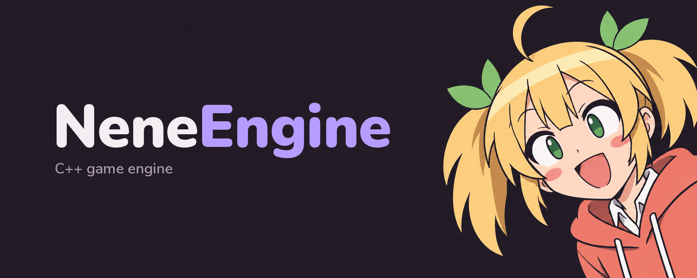

<p align="center">
  <a href="LICENSE.txt"></a>
  <a href="#getting-started"></a>
  <a href="https://en.cppreference.com/w/cpp/20"></a>
  <a href="https://github.com/NeneTech-Ind/NeneEngine/commits/master"></a>
</p>

<p align="center"><b>A small C++20 game engine for Windows with a built-in editor</b></p>

NeneEngine renders with DirectX 12 and keeps its world in an Entity-Component-System, with Jolt for physics and an editor. Engine settings, scenes and asset descriptions are plain JSON files, so you can change them without recompiling.

Built with [Diligent Engine](https://github.com/DiligentGraphics/DiligentEngine), [EnTT](https://github.com/skypjack/entt), [Jolt Physics](https://github.com/jrouwe/JoltPhysics), [Dear ImGui](https://github.com/ocornut/imgui), [ImGuizmo](https://github.com/CedricGuillemet/ImGuizmo), [Assimp](https://github.com/assimp/assimp), [EASTL](https://github.com/electronicarts/EASTL), [enkiTS](https://github.com/dougbinks/enkiTS), [spdlog](https://github.com/gabime/spdlog) and [Tracy](https://github.com/wolfpld/tracy).

## Features

### Editor

- Dockable Hierarchy, Inspector, Viewport, Asset Browser and Statistics panels
- Frame time graph and percentiles in the Statistics panel, with switches for the job system in rendering and physics
- Edit and Play modes: Play snapshots the scene, Stop restores it
- Undo and redo for component changes
- Transform gizmo for moving, rotating and scaling in local or world space
- Saving and loading scenes, with a prompt to save unsaved changes
- Material editing in the Inspector: colors, textures and shaders
- Drag and drop of models and textures from the Asset Browser
- Evening and Day themes, Lucide icons, a chibi mascot and scaling with monitor DPI

### Runtime

- DirectX 12 renderer through Diligent Engine with textured meshes and built-in primitives
- Multiple windows sharing one D3D12 device, each with its own camera and input focus
- ECS on EnTT with an event bus, scene hierarchy and systems for movement, player control, cameras, physics and rendering
- Jolt physics with static and dynamic bodies, collision events and a collider debug view
- Model import through Assimp, as one entity or one entity per mesh part
- Asynchronous asset loading on streaming workers, with GPU uploads spread over several frames
- Job system on enkiTS, shared by physics, movement and render preparation
- Thread-safe resource manager with typed loaders and caching
- Game state machine with Play and Pause
- Hot reload of the clear color and input bindings from the engine config
- CPU profiling with Tracy in Debug and Release builds

## Getting started

### Requirements

- Windows x64
- Visual Studio with the MSVC toolchain
- CMake 3.19 or newer and Ninja
- [vcpkg](https://github.com/microsoft/vcpkg) with the `VCPKG_ROOT` environment variable set

### Build

Clone with submodules, then configure and build from a Visual Studio developer prompt:

```bash
git clone --recurse-submodules https://github.com/NeneTech-Ind/NeneEngine.git
```

```bash
cmake --preset x64-debug
cmake --build out/build/x64-debug --config Debug
```

Use the `x64-release` preset and `out/build/x64-release` for a Release build. vcpkg installs the remaining dependencies during configure.

To get a self-contained folder with the executable, DLLs and assets in `out/install/x64-debug/bin/`:

```bash
cmake --install out/build/x64-debug --config Debug --component Runtime
```

### Run

Start `NeneEngine.exe`. The editor opens the demo scene from `assets/scenes/demo_scene.json` in Edit mode. A stress scene with ten thousand cubes, `assets/scenes/stress_scene.json`, can be opened from the File menu. The log goes to `logs/nene_engine.log` next to the executable.

| Option                | Effect                                                                  |
| --------------------- | ----------------------------------------------------------------------- |
| `--smoke-test`        | Initializes the engine, loads the scene and exits before the frame loop |
| `--wait-for-profiler` | Waits up to 30 seconds for a Tracy profiler to connect before starting  |

The `NENEENGINE_ENABLE_TRACY` CMake option turns Tracy on and is on by default. Tracy records only while a profiler is connected.

### Controls

| Keys                     | Action                               |
| ------------------------ | ------------------------------------ |
| `Ctrl+P`                 | Enter or leave Play mode             |
| `Ctrl+Z`, `Ctrl+Y`       | Undo, redo                           |
| `Ctrl+S`, `Ctrl+Shift+S` | Save scene, save scene as            |
| `Ctrl+O`                 | Load scene                           |
| `W`, `E`, `R`            | Move, rotate, scale gizmo            |
| `X`                      | Switch gizmo between local and world |
| `F3`                     | Show or hide colliders               |

## Project layout

| Path        | Contents                                                                                        |
| ----------- | ----------------------------------------------------------------------------------------------- |
| `include/`  | Public headers, one folder per module                                                           |
| `src/`      | Sources: `App`, `Core`, `ECS`, `Editor`, `GameStates`, `Graphics`, `Input`, `Platform`, `Scene` |
| `assets/`   | Engine config, scenes, models, shaders, fonts and editor artwork                                |
| `external/` | Submodules: Diligent Engine, Dear ImGui, ImGuizmo                                               |
| `docs/`     | Project conventions                                                                             |

## Contributing

Read the [Git conventions](docs/conventions/git-convention.md) and [naming conventions](docs/conventions/naming-convention.md) before opening a branch.

## Authors

- [BennySpace](https://github.com/BennySpace) (Daniil Vlasov)
- [Wesdmond](https://github.com/Wesdmond) (Timofey Shabanov)
- [AmuroVP](https://github.com/AmuroVP) (Ivan Korotikhin)

## License

NeneEngine is released under the [MIT License](LICENSE.txt). Third-party libraries, fonts, icons and models keep their own licenses, listed in [THIRD_PARTY_NOTICES.txt](THIRD_PARTY_NOTICES.txt).
